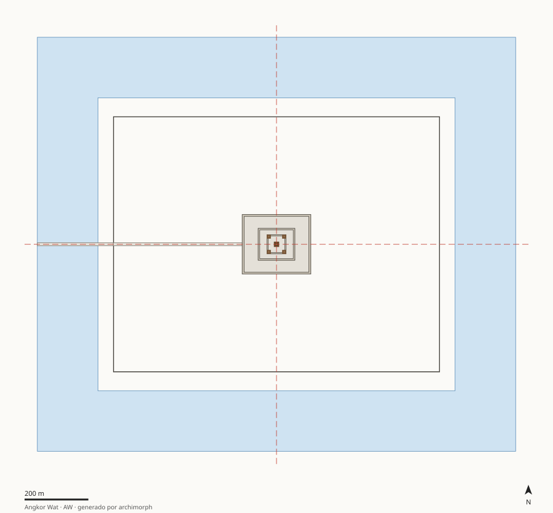

# AW · Angkor Wat

Camboya — Siem Reap, llanura aluvial del Tonlé Sap · 1113–1150 · Imperio jemer, reinado de Suryavarman II

Templo-montaña concéntrico: dos regímenes de escala (territorial y arquitectónico), aspecto autosemejante ~1.15 y un núcleo en quincunce. La restricción física activa es el terreno arenoso, no la piedra.

## Estructura

| Carpeta | Contenido |
|---|---|
| [`docs/`](docs/) | `contexto_hipotesis.md` (contexto, preguntas, hipótesis AW-H1, AW-H2, AW-H3, AW-H4, restricciones de época) y `fuentes.md` |
| [`analysis/`](analysis/) | `patrones_proporciones.md`: composición, simetría, cánones con control de azar, modulación, masa/vacío |
| [`cad_parametric/`](cad_parametric/) | `parametros.json` + `modelo_parametrico.py` (regla generativa) + `ingenieria_inversa.md`; salidas SVG/OBJ/JSON en `salida/` |
| [`data/`](data/) | `elementos.csv` (medidas con calidad e incertidumbre), `descriptores.json` (metadatos y etiquetas), `features.json` (generado) |



## Features principales (generadas)

| Feature | Valor |
|---|---|
| Tipología | `templo_montana` |
| Patrón compositivo | `concentrico_rectangular` |
| Grupo de simetría | `D2` |
| Razón de anidamiento r (R²) | 0.399 (0.98) |
| Aspecto del recinto principal | 1.277 |
| Esbeltez de la masa principal | 0.32 |
| Tensión de peso propio en base | 0.161 MPa |
| Factor de seguridad (f_c mín.) | 124 |
| Fracción de ocupación | 0.06 |

Proporción de datos por calidad: A = 44%, B = 22%, C = 33%
(ver criterios en `06_global-data-vault/schema/diccionario_datos.md`).

## Reproducir

```bash
python3 cad_parametric/modelo_parametrico.py          # solo este caso
make -C .. all                                        # pipeline completo desde la raíz
```
