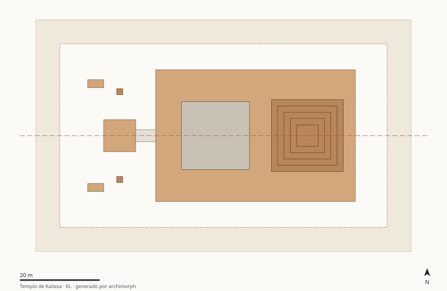

# KL · Templo de Kailasa (Cueva 16, Ellora)

India — Maharashtra, escarpe basáltico de Ellora (Traps del Decán) · 756–773 · Dinastía Rashtrakuta, atribuido a Krishna I

Arquitectura sustractiva: el proyecto es un balance de materia (≈74 000 m³ extraídos, ≈16 000 m³ retenidos). Secuencia axial bilateral; la forma la gobierna la irreversibilidad del proceso.

## Estructura

| Carpeta | Contenido |
|---|---|
| [`docs/`](docs/) | `contexto_hipotesis.md` (contexto, preguntas, hipótesis KL-H1, KL-H2, KL-H3, KL-H4, restricciones de época) y `fuentes.md` |
| [`analysis/`](analysis/) | `patrones_proporciones.md`: composición, simetría, cánones con control de azar, modulación, masa/vacío |
| [`cad_parametric/`](cad_parametric/) | `parametros.json` + `modelo_parametrico.py` (regla generativa) + `ingenieria_inversa.md`; salidas SVG/OBJ/JSON en `salida/` |
| [`data/`](data/) | `elementos.csv` (medidas con calidad e incertidumbre), `descriptores.json` (metadatos y etiquetas), `features.json` (generado) |



## Features principales (generadas)

| Feature | Valor |
|---|---|
| Tipología | `templo_monolitico_excavado` |
| Patrón compositivo | `axial_lineal` |
| Grupo de simetría | `D1` |
| Razón de anidamiento r (R²) | 0.390 (0.97) |
| Aspecto del recinto principal | 1.783 |
| Esbeltez de la masa principal | 1.67 |
| Tensión de peso propio en base | 0.341 MPa |
| Factor de seguridad (f_c mín.) | 293 |
| Fracción de ocupación | 0.44 |

Proporción de datos por calidad: A = 25%, B = 0%, C = 75%
(ver criterios en `06_global-data-vault/schema/diccionario_datos.md`).

## Reproducir

```bash
python3 cad_parametric/modelo_parametrico.py          # solo este caso
make -C .. all                                        # pipeline completo desde la raíz
```
