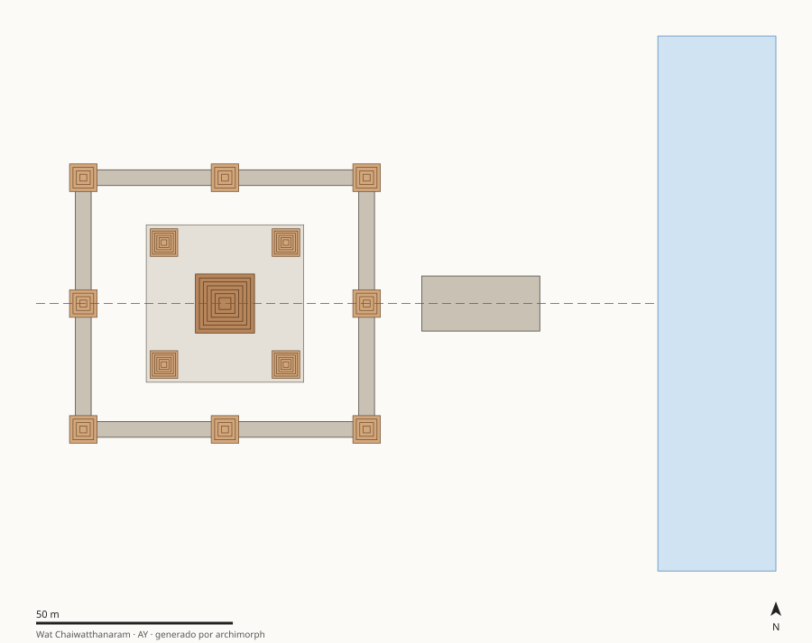

# AY · Ciudad histórica de Ayutthaya (caso focal: Wat Chaiwatthanaram) con Sukhothai como referencia

Tailandia — Llanura del Chao Phraya, provincia de Phra Nakhon Si Ayutthaya · 1630–1650 · Reino de Ayutthaya, reinado de Prasat Thong (ciudad: 1351-1767)

Reinterpretación del templo-montaña jemer (quincunce + recinto + eje) con verticalización: la altura se escala 1.5 veces más que la planta. A escala urbana, el río sustituye al foso.

## Estructura

| Carpeta | Contenido |
|---|---|
| [`docs/`](docs/) | `contexto_hipotesis.md` (contexto, preguntas, hipótesis AY-H1, AY-H2, AY-H3, AY-H4, restricciones de época) y `fuentes.md` |
| [`analysis/`](analysis/) | `patrones_proporciones.md`: composición, simetría, cánones con control de azar, modulación, masa/vacío |
| [`cad_parametric/`](cad_parametric/) | `parametros.json` + `modelo_parametrico.py` (regla generativa) + `ingenieria_inversa.md`; salidas SVG/OBJ/JSON en `salida/` |
| [`data/`](data/) | `elementos.csv` (medidas con calidad e incertidumbre), `descriptores.json` (metadatos y etiquetas), `features.json` (generado) |



## Features principales (generadas)

| Feature | Valor |
|---|---|
| Tipología | `wat_real_quincunce` |
| Patrón compositivo | `quincunce_en_recinto` |
| Grupo de simetría | `D2` |
| Razón de anidamiento r (R²) | 0.444 (0.99) |
| Aspecto del recinto principal | 1.118 |
| Esbeltez de la masa principal | 2.33 |
| Tensión de peso propio en base | 0.247 MPa |
| Factor de seguridad (f_c mín.) | 20 |
| Fracción de ocupación | 0.35 |

Proporción de datos por calidad: A = 0%, B = 12%, C = 88%
(ver criterios en `06_global-data-vault/schema/diccionario_datos.md`).

## Reproducir

```bash
python3 cad_parametric/modelo_parametrico.py          # solo este caso
make -C .. all                                        # pipeline completo desde la raíz
```
