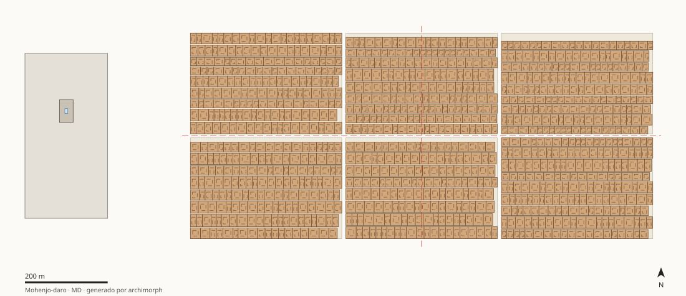

# MD · Mohenjo-daro

Pakistán — Sindh, llanura aluvial del Indo · 2500 a.C.–1900 a.C. · Fase harappana madura

Caso de control reticular: una norma repetible (ladrillo 1:2:4, calle, manzana, casa-patio) genera orden por agregación a lo largo de casi cuatro órdenes de magnitud.

## Estructura

| Carpeta | Contenido |
|---|---|
| [`docs/`](docs/) | `contexto_hipotesis.md` (contexto, preguntas, hipótesis MD-H1, MD-H2, MD-H3, MD-H4, restricciones de época) y `fuentes.md` |
| [`analysis/`](analysis/) | `patrones_proporciones.md`: composición, simetría, cánones con control de azar, modulación, masa/vacío |
| [`cad_parametric/`](cad_parametric/) | `parametros.json` + `modelo_parametrico.py` (regla generativa) + `ingenieria_inversa.md`; salidas SVG/OBJ/JSON en `salida/` |
| [`data/`](data/) | `elementos.csv` (medidas con calidad e incertidumbre), `descriptores.json` (metadatos y etiquetas), `features.json` (generado) |



## Features principales (generadas)

| Feature | Valor |
|---|---|
| Tipología | `ciudad_reticular_planificada` |
| Patrón compositivo | `reticular_ortogonal` |
| Grupo de simetría | `p2mm_traslacional` |
| Razón de anidamiento r (R²) | 0.125 (0.96) |
| Aspecto del recinto principal | 1.500 |
| Esbeltez de la masa principal | 0.04 |
| Tensión de peso propio en base | 0.170 MPa |
| Factor de seguridad (f_c mín.) | 6 |
| Fracción de ocupación | 0.70 |

Proporción de datos por calidad: A = 29%, B = 0%, C = 71%
(ver criterios en `06_global-data-vault/schema/diccionario_datos.md`).

## Reproducir

```bash
python3 cad_parametric/modelo_parametrico.py          # solo este caso
make -C .. all                                        # pipeline completo desde la raíz
```
