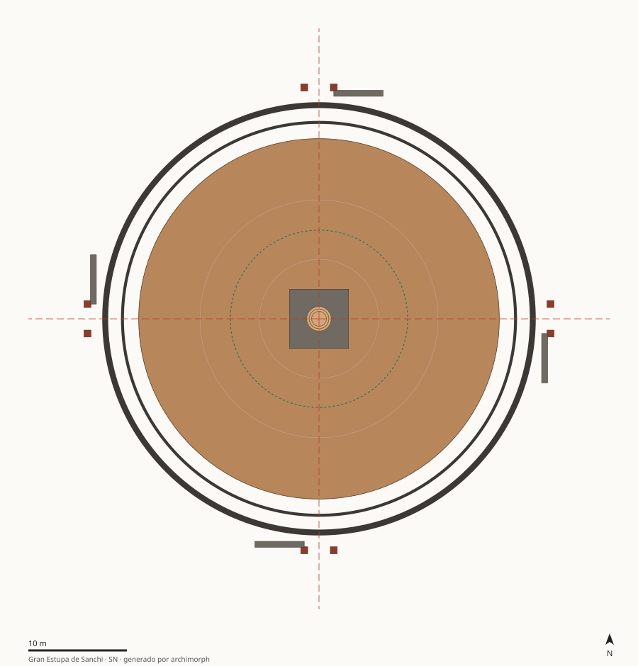

# SN · Gran Estupa de Sanchi (Estupa 1)

India — Madhya Pradesh, colina de Sanchi (meseta de Vindhya) · 250 a.C.–50 a.C. · Fundación maurya (Ashoka), ampliación shunga, toranas satavahana

Masa radial maciza con simetría C4 quiral (accesos en molinete) y crecimiento por encapsulamiento homotético (×2 en diámetro, ×8.4 en volumen).

## Estructura

| Carpeta | Contenido |
|---|---|
| [`docs/`](docs/) | `contexto_hipotesis.md` (contexto, preguntas, hipótesis SN-H1, SN-H2, SN-H3, SN-H4, restricciones de época) y `fuentes.md` |
| [`analysis/`](analysis/) | `patrones_proporciones.md`: composición, simetría, cánones con control de azar, modulación, masa/vacío |
| [`cad_parametric/`](cad_parametric/) | `parametros.json` + `modelo_parametrico.py` (regla generativa) + `ingenieria_inversa.md`; salidas SVG/OBJ/JSON en `salida/` |
| [`data/`](data/) | `elementos.csv` (medidas con calidad e incertidumbre), `descriptores.json` (metadatos y etiquetas), `features.json` (generado) |



## Features principales (generadas)

| Feature | Valor |
|---|---|
| Tipología | `estupa` |
| Patrón compositivo | `radial_concentrico` |
| Grupo de simetría | `C4` |
| Razón de anidamiento r (R²) | 0.353 (0.92) |
| Aspecto del recinto principal | 1.000 |
| Esbeltez de la masa principal | 0.51 |
| Tensión de peso propio en base | 0.205 MPa |
| Factor de seguridad (f_c mín.) | 15 |
| Fracción de ocupación | 0.69 |

Proporción de datos por calidad: A = 14%, B = 0%, C = 86%
(ver criterios en `06_global-data-vault/schema/diccionario_datos.md`).

## Reproducir

```bash
python3 cad_parametric/modelo_parametrico.py          # solo este caso
make -C .. all                                        # pipeline completo desde la raíz
```
