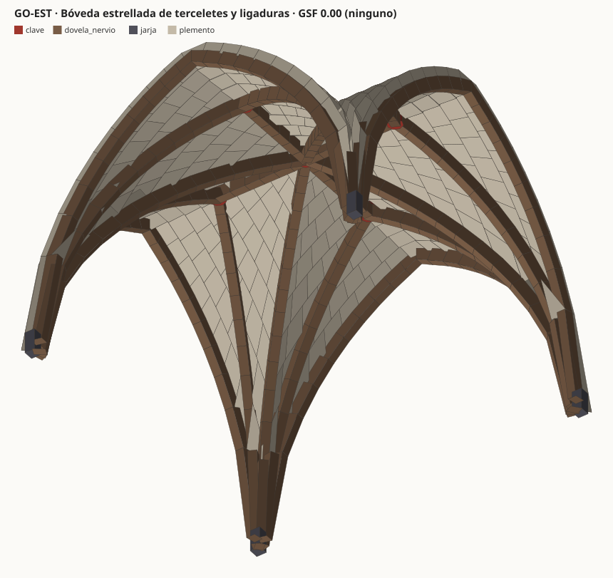

# 07 · Síntesis estereotómica (ESTM)

Pipeline en Python para analizar, extraer y sintetizar patrones de obras
históricas de fábrica de alta complejidad (estereotomía, crucería gótica,
nervadas califales, mocárabes) y entregarlos como piezas de fabricación
OpenBIM.



## Qué hace

| Etapa | Módulo | Resultado |
|---|---|---|
| Representación | `estm/grafo.py`, `estm/geometria.py` | Grafo atribuido relacional G = (V, E): piezas con volumen, masa y caja orientada; juntas con área, normal e inclinación |
| Gramática | `estm/generadores/` | Genoma de 10 genes que genera arcos, crucerías, estrelladas, nervadas {n/k}, mocárabes e híbridos |
| Equilibrio | `estm/tna.py`, `estm/analisis.py` | Límite inferior de Heyman: líneas de empujes, método de los cortes, rebanadas, TNA (arista y anillos), GSF y estribos |
| Fabricación | `estm/fabricacion.py` | DfAM para piedra CNC y 3DCP pieza a pieza, secuencia de montaje y cimbra |
| Patrones | `estm/patrones.py` | Firmas Weisfeiler-Lehman, espectro y descriptores de pieza |
| Aprendizaje continuo | `estm/memoria.py` | Diccionario de prototipos con memoria episódica: retención 1.000 y reproducible desde el registro |
| Síntesis | `estm/latente.py` | slerp entre genomas de tradiciones distintas, con verificación y reparación mínima |
| Interoperabilidad | `estm/interop/` | IFC 4.3 + Psets `ESTM_*` + IDS validado, Speckle, Grasshopper (LOD 400) |

## Resultados (cifras completas en [`salidas/informe.md`](salidas/informe.md))

| Obra | Piezas | Equilibrio | GSF |
|---|---|---|---|
| Arco de medio punto (referencia) | 29 | admisible | 1.31 |
| Arco apuntado equilátero | 29 | admisible | 1.23 |
| Crucería cuatripartita (12 m) | 438 | admisible (cortes) | 1.09 |
| Estrellada de terceletes (12 m) | 642 | no encontrado (cortes 0.98) | — |
| Nervada califal {8/3} (7 m) | 361 | admisible (rebanada) | 1.66 |
| Mocárabes, versión en fábrica (8 m) | 569 | no encontrado (rebanada 0.94) | — |

- **Validación del solver:** arco de medio punto t/R = 0.1081 frente a 0.1075 (Milankovitch, Heyman).
- **Síntesis:** 6 híbridos gótico ↔ nazarí y califal ↔ gótico tardío, todos admisibles tras la reparación (GSF 1.30–1.86). La fabricabilidad de los híbridos es baja (25–61 %): mezclar lechos horizontales con superficies de doble curvatura alabea las juntas.
- **Memoria:** 126 prototipos sobre 4 544 piezas, retención 1.000, estado reproducible, 47 patrones compartidos por al menos dos tradiciones.
- **OpenBIM:** 2 lotes IFC 4.3 (4 544 piezas, 13 392 juntas como `IfcRelConnectsElements`) que cumplen el IDS LOD 400 al 100 %.

## Uso

```bash
pip install -r requirements.txt          # numpy, ifcopenshell, ifctester (ver notas)
python3 pipeline.py                      # todo (~7 min)
python3 pipeline.py --rapido             # solo el catálogo
python3 pipeline.py --interop-todo       # cargas Speckle/GH de todas las obras
python3 -m unittest discover -s tests    # 23 pruebas
```

Desde la raíz del repositorio: `make estm` y `make estm-test`.

## Salidas

```
salidas/
├── obras/<ID>/        grafo.json · analisis.json · axonometria.svg · seccion_empujes.svg
├── sintesis/<HX-…>/   lo mismo para cada híbrido (incluye la traza de reparación)
├── memoria/           diccionario.json · eventos.jsonl (registro sin pérdida) · resumen.json
├── ifc/               catalogo_historico.ifczip · sintesis_hibridos.ifczip · estm_lod400.ids · validacion.json
├── interop/           GO-CR4_speckle.json · GO-CR4_gh.json (ejemplo)
├── informe.md · resumen.json
└── local/             IFC sin comprimir y cargas pesadas (no versionado)
```

## Documentación

- [`docs/fundamentos.md`](docs/fundamentos.md): grafo, gramática, métodos de Heyman y TNA, DfAM, memoria y slerp, con sus límites.
- [`docs/interoperabilidad.md`](docs/interoperabilidad.md): protocolo IFC 4.3, Psets, IDS, GUID, Speckle, Grasshopper y alcance real del LOD 400.

## Límites, sin rodeos

- Las obras son **reconstrucciones tipológicas**, no levantamientos. Antes de cualquier uso patrimonial hay que sustituirlas por fotogrametría o LiDAR.
- La verificación es de **límite inferior**: si no se encuentra solución, eso no prueba el colapso.
- Los mocárabes nazaríes reales son de yeso no portante. Se analiza una versión hipotética en fábrica, con celdas prismáticas sin alvéolo curvo.
- La conexión con Speckle (`speckle.enviar`) y el script de Grasshopper no se han ejecutado contra un servidor ni dentro de Rhino.
- LOD 400 cubre geometría, uniones, materiales y datos de fabricación y montaje por pieza. No incluye G-code ni trayectorias de impresión.
